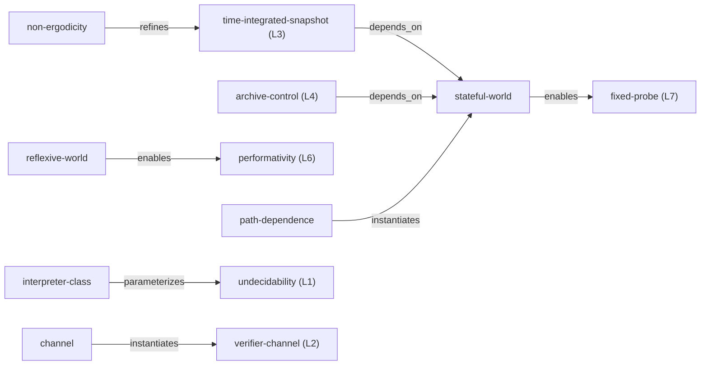
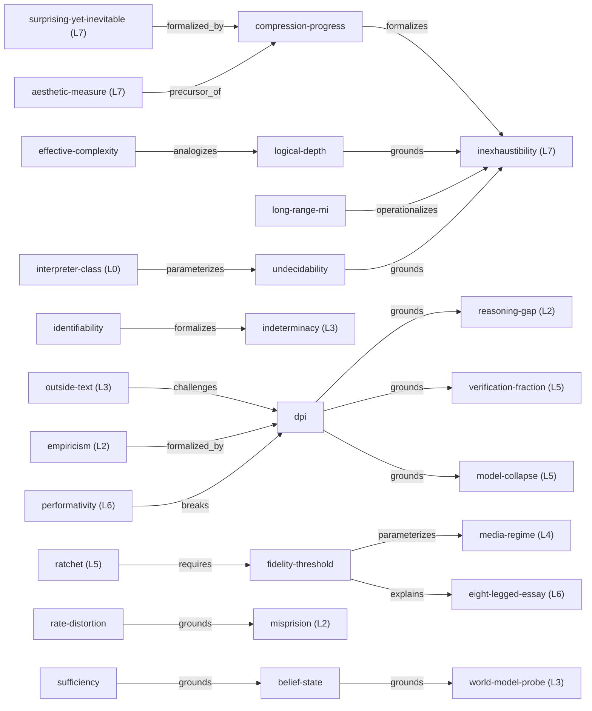
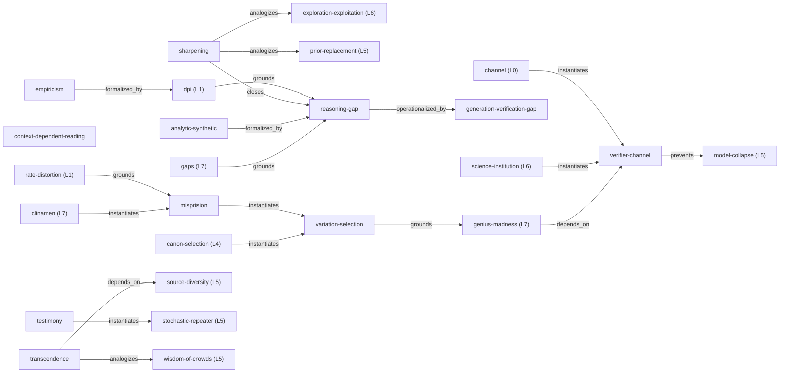
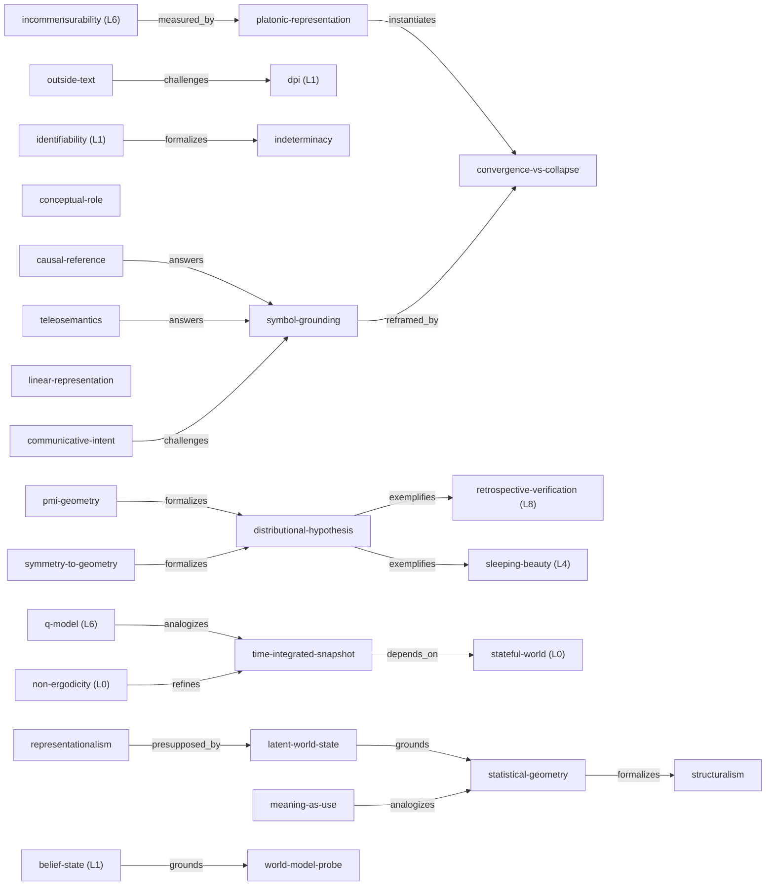
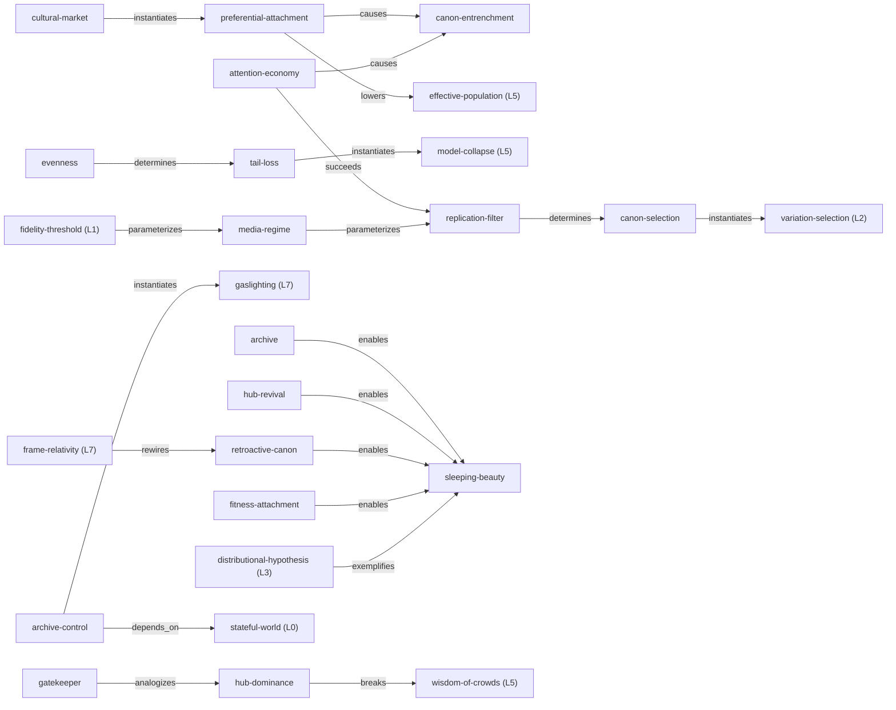
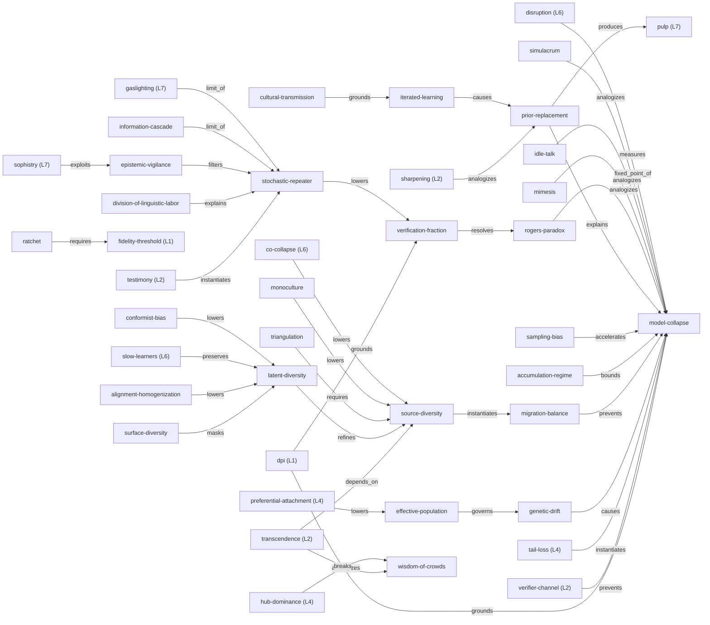
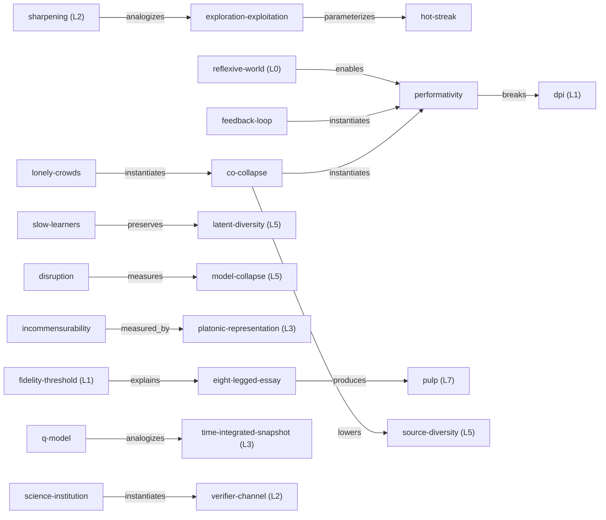
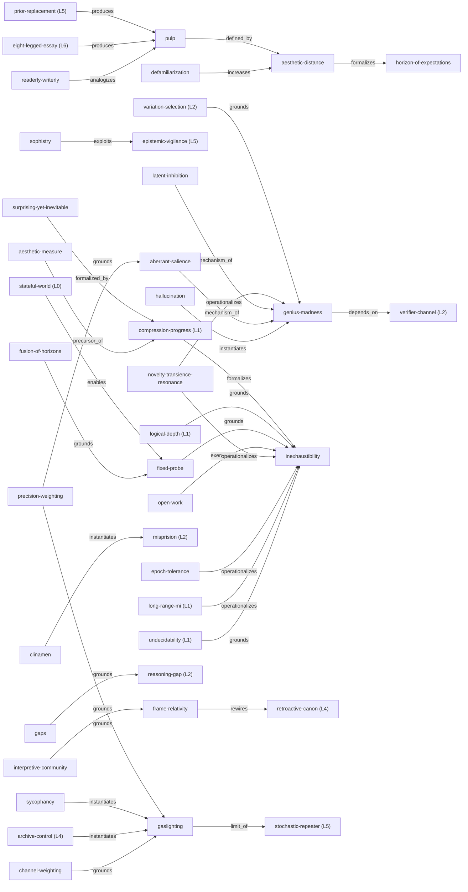
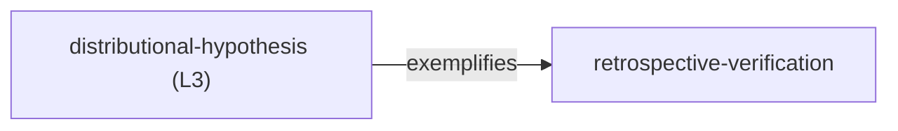

# Concept map

*Generated by `program/tools/render.py` from `data/concepts.json`. Edit the source, not this file.*

Each diagram shows one layer's concepts and every edge touching them.

## L0. Mathematical primitives

- **channel**: A Markov kernel K: X -> Delta(Y); every relation in the spine (perceive, write, copy, read, train, verify) is one. `K(y|x)`
- **stateful-world**: The world process Omega_t has memory and is non-stationary; Omega_t != Omega_{t+1}; history matters. `omega_{t+1} ~ P(.|omega_{<=t})`
- **reflexive-world**: The part of Omega made of agents and their artifacts, which changes in response to models of it. `Omega_{t+1} depends on theta_t`
- **non-ergodicity**: Ensemble averages (corpus) differ from time averages (a life).
- **path-dependence**: Early contingent events select absorbing states.
- **interpreter-class**: Computational power of readers: finite, TC0, universal.

## L1. Information-theoretic and computational laws

- **undecidability**: Deductive closure of a corpus is r.e. but not decidable.
- **dpi**: Data-processing inequality: processing cannot increase information about a source. `X->Y->Z => I(X;Z)<=I(X;Y)`
- **rate-distortion**: Below the source rate, distortion is positive: misreading is forced. `D(R)>0`
- **sufficiency**: A statistic retaining all information about a parameter; optimal predictors encode posterior sufficient statistics.
- **belief-state**: Posterior over hidden states; represented geometrically by optimal predictors (mixed-state simplex).
- **identifiability**: Representations determined up to an equivalence class by the data distribution.
- **compression-progress**: Rate of improvement in an observer's compression of data; Schmidhuber's interestingness. `-dK_t(x)/dt`
- **logical-depth**: Computation time needed to generate x from its shortest description.
- **effective-complexity**: Length of the description of a thing's regularities.
- **fidelity-threshold**: Eigen error threshold: maximal persistent content scales as ln(sigma)/epsilon. `K <~ ln sigma / eps`
- **long-range-mi**: Mutual information between symbols as a function of distance; power-law in natural text.

## L2. Reading, misprision, selection

- **reasoning-gap**: F*(D) - F(theta): content implicit in a corpus but not yet extracted; the analytic residue.
- **generation-verification-gap**: How much better a model verifies than generates; governs self-improvement.
- **sharpening**: Self-improvement by concentrating probability on self-verified outputs; adds no grounded information.
- **verifier-channel**: An evidence source E_ver conditionally independent of D given Omega (proof checker, execution, experiment). `I(Omega;E_ver|D)>0`
- **transcendence**: Aggregated learner beating each source by denoising; requires independent errors.
- **misprision**: Gap between hearer's reading and speaker's meaning; Bloom's creative misreading; GM's core object.
- **context-dependent-reading**: Readings depend on hearer context (pragmatics).
- **variation-selection**: Blind variation and selective retention as engine of knowledge growth.
- **testimony**: Knowledge from others' words; LLMs as pure testimony reasoners.
- **empiricism**: Knowledge of matters of fact requires experience.
- **analytic-synthetic**: Distinction between truths by meaning/deduction and truths about the world.

## L3. Language and geometry

- **distributional-hypothesis**: Meaning is reflected in distribution (Harris, Firth).
- **statistical-geometry**: Geometry of representations induced by co-occurrence statistics.
- **pmi-geometry**: Embeddings factorize (shifted) pointwise mutual information.
- **symmetry-to-geometry**: Group-invariant co-occurrence forces representation geometry given by irreps.
- **latent-world-state**: Text generated by a hidden world-state process.
- **linear-representation**: Concepts as linear directions in representation space.
- **world-model-probe**: Decoding latent world variables from model internals (Othello, space-time, color).
- **platonic-representation**: Convergence of representations across models and modalities.
- **convergence-vs-collapse**: delta->0 with G rising (convergence on Omega) vs G falling (collapse onto each other).
- **time-integrated-snapshot**: A model's world is a composite of the corpus's historical states, frozen at training.
- **symbol-grounding**: How symbols acquire meaning; spine: possible as state, impossible as process.
- **communicative-intent**: Bender-Koller requirement for meaning; outside the spine's claims.
- **conceptual-role**: Meaning constituted by inferential role.
- **causal-reference**: Reference fixed by causal-historical chains (Kripke, Putnam).
- **teleosemantics**: Content fixed by selection history.
- **indeterminacy**: Quine: multiple translation manuals fit all behavior; = identifiability class.
- **meaning-as-use**: Wittgenstein: meaning is use.
- **structuralism**: Meaning as a system of differences (Saussure).
- **representationalism**: Knowledge as mirroring reality; contested by pragmatists.
- **outside-text**: Derrida: no outside-text; if true, G is undefined.

## L4. Media, archives, canon network

- **replication-filter**: Copy iff perceived value exceeds cost; c sets the canon threshold. `v > c`
- **media-regime**: Oral, manuscript, print, digital, generative: points in (c, phi, n).
- **evenness**: Distribution of copies across works; low evenness loses works.
- **tail-loss**: Rare variants lost first under resampling or copy loss.
- **archive**: Store of forms with provenance; Foucault's law of the sayable.
- **archive-control**: Adversarial control of the archive.
- **canon-selection**: Processes by which works enter and persist in the canon.
- **canon-entrenchment**: Attention concentrating on canonical works as fields grow.
- **attention-economy**: When information is abundant, attention is the scarce filter.
- **preferential-attachment**: New links attach in proportion to existing degree (Matthew effect). `P(i) ~ k_i`
- **fitness-attachment**: Attachment proportional to fitness x degree; latecomers can overtake. `P(i) ~ eta_i k_i`
- **cultural-market**: Markets for cultural goods with social influence; inequality and unpredictability.
- **sleeping-beauty**: Work with delayed recognition after dormancy.
- **retroactive-canon**: Later works re-weight earlier ones (Eliot, Borges): backward edges.
- **hub-revival**: A high-attention node redirects attention to a dormant work.
- **gatekeeper**: Node controlling admission to the canon.
- **hub-dominance**: A node with influence weight bounded away from zero; breaks wisdom of crowds.

## L5. Population ecology of knowledge

- **effective-population**: N_e = 1/sum w_i^2; governs drift rate.
- **genetic-drift**: Random fluctuation of variant frequencies under finite sampling; leads to fixation.
- **migration-balance**: Equilibrium diversity under migration/mutation vs drift. `H ~ 4Nm/(1+4Nm)`
- **source-diversity**: delta: divergence among sources contributing to a corpus. `generalized JS divergence`
- **latent-diversity**: Diversity of content in latent space, style factored out. `I(source;content)`
- **surface-diversity**: Diversity of style/form; can mask latent homogeneity. `I(source;style)`
- **model-collapse**: Degeneration of a self-consuming generative chain (8 definitions: Schaeffer 2025).
- **accumulation-regime**: Training where data accumulate rather than replace; bounds collapse.
- **sampling-bias**: Quality-seeking sampling (temperature<1, top-p) that reduces entropy per generation.
- **iterated-learning**: Chains of learners each trained on the previous one's output.
- **prior-replacement**: Iterated learning converges to the learners' prior.
- **cultural-transmission**: Quantitative models of how culture passes between individuals.
- **conformist-bias**: Disproportionate copying of the majority.
- **rogers-paradox**: Social learning does not raise mean fitness in changing environments.
- **verification-fraction**: v: share of agents or events checking Omega directly; v* is the threshold.
- **stochastic-repeater**: An agent transmitting testimony with minimal verification of Omega.
- **division-of-linguistic-labor**: Reference and knowledge held by a community via deference.
- **epistemic-vigilance**: Cheap mechanisms for filtering testimony; checks against prior.
- **information-cascade**: Agents ignore private signals and copy predecessors.
- **wisdom-of-crowds**: Aggregation of independent estimates converges to truth.
- **triangulation**: Davidson: objectivity from two interpreters and a shared world.
- **monoculture**: Many decision-makers using the same model.
- **alignment-homogenization**: Preference tuning reduces output diversity.
- **mimesis**: Imitation as copy of copy (Plato).
- **idle-talk**: Heidegger's Gerede: discourse decoupled from its referent.
- **simulacrum**: Sign referring to signs; fixed point of self-consumption.
- **ratchet**: Cumulative cultural evolution requiring fidelity.

## L6. Institutions, pedagogy, careers, reflexivity

- **performativity**: Models and utterances change what they describe. `Omega_{t+1}=f(Omega_t, theta_t)`
- **feedback-loop**: Model outputs re-enter training data.
- **co-collapse**: Human sources losing diversity toward models.
- **lonely-crowds**: Concentrated attention with reduced interaction (Hao et al.).
- **disruption**: CD index measure of whether work eclipses its predecessors.
- **exploration-exploitation**: Trade-off between searching new options and refining known ones.
- **slow-learners**: March: members slow to adopt the code preserve diversity.
- **q-model**: Impact = Q x luck; stable Q over a career. `c = Q p`
- **hot-streak**: Clustered period of high-impact work; onset after exploration then exploitation.
- **science-institution**: Peer review, priority, organized skepticism: novelty plus verification.
- **eight-legged-essay**: Ming-Qing exam essay form: conservation at maximal fidelity without grounding.
- **incommensurability**: Kuhn: paradigms lack common measure; alignment metrics as partial measure.

## L7. Value, interpretation, pathology

- **pulp**: Text whose value is exhausted on first reading; ~0 aesthetic distance from genre prior.
- **inexhaustibility**: Sustained new content under rereading.
- **horizon-of-expectations**: Jauss: readers' framework of expectations.
- **aesthetic-distance**: Gap between horizon and work; formalized as KL from text to horizon.
- **defamiliarization**: Shklovsky: art de-automatizes perception.
- **readerly-writerly**: Barthes: consumed vs co-produced texts.
- **open-work**: Eco: works that admit many coherent readings.
- **gaps**: Iser: indeterminacies the reader fills.
- **interpretive-community**: Fish: communities constituting readings.
- **frame-relativity**: Value or category depends on interpretive frame.
- **fusion-of-horizons**: Gadamer: understanding as merging historical horizons.
- **fixed-probe**: A fixed text read against a changing reader/world yields new readings.
- **surprising-yet-inevitable**: Improbable under prior, short under own code.
- **aesthetic-measure**: Formal measures of aesthetic value (Birkhoff, Berlyne).
- **novelty-transience-resonance**: KL to past (novelty), to future (transience); resonance = persistent novelty.
- **epoch-tolerance**: How many training repetitions of a text remain useful; proposed literariness proxy.
- **clinamen**: Bloom: the strong poet's swerve from a precursor; engineered diversity.
- **genius-madness**: Both large deviations; distinguished by coupling to Omega.
- **latent-inhibition**: Filtering of previously irrelevant stimuli; reduced in creativity and psychosis-proneness.
- **aberrant-salience**: Significance attributed to noise.
- **precision-weighting**: Relative weight of priors vs prediction errors (or own vs others' evidence).
- **hallucination**: Confident output uncoupled from Omega; formal madness.
- **sycophancy**: Model deferring to user over own evidence.
- **gaslighting**: Adversary drives victim's precision on own perception toward zero.
- **channel-weighting**: Unequal credibility assigned to speakers' channels (epistemic injustice).
- **sophistry**: Speaker optimizing hearer acceptance against weak tests.

## L8. LLMs as instruments; retrospective verification

- **retrospective-verification**: Using a later apparatus (LLMs) to test claims long argued in a field.
