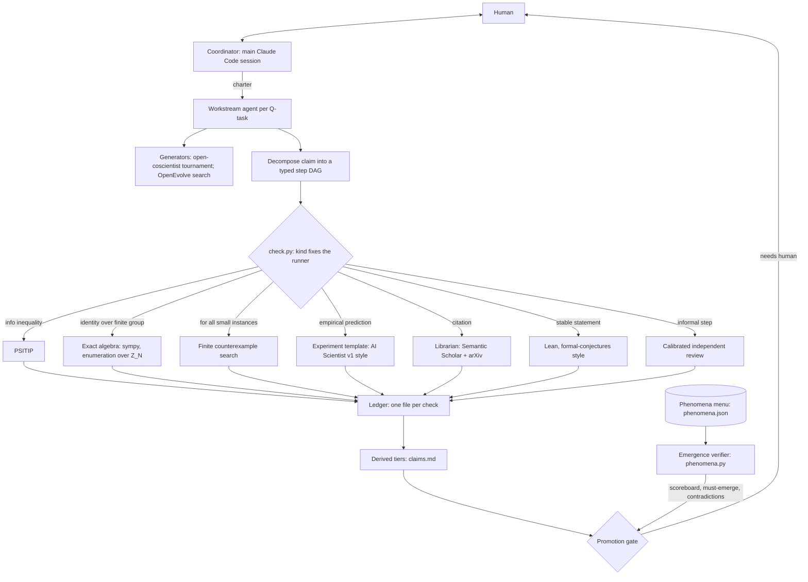

# The research harness: how it runs and how it verifies

*v0.3 · 2026-11-22. This turns [`tooling.md`](tooling.md) into an operating specification. "Exists" marks a part that is already in the repo. "Build" marks a part that is proposed. v0.3 replaces the stored `verification` object with a check ledger and derived tiers, folds the router into `tools/check.py`, and drops PaperOrchestra, which drafts papers but does nothing for the grounding loop. Current verdicts: [`claims.md`](claims.md).*

## 1. Summary

The harness is a co-mathematician-style workbench running on Claude Code. Its shared state is `program/data/*.json` on a git branch.

- A **coordinator** turns tasks into workstreams. Each workstream decomposes its claim into typed steps.
- Each step is a **check**: a typed record in `program/checks/*.py` whose type fixes its verifier (an information-inequality prover, an exact witness, exact computation, finite counterexample search, a simulation template, a citation check, or Lean). `tools/check.py` runs it and writes one verdict file to `program/ledger/`.
- Steps no machine can check go through a calibrated, *conditionally independent* review protocol, which ends at a human gate.
- Whole formalisms are also checked against their literatures by the **emergence verifier** (§5.5). It counts how many behaviors that linguistics, cultural evolution, anthropology, literary studies, philosophy and ML have theorized or observed emerge from the formalism's core premises, and how many have to be bolted on by hand.
- Nothing advances a claim except a recorded verdict. A claim's tier is derived from the ledger, never typed in. Every failure is kept.

All LLM calls, including those inside third-party tools, go through `claude -p`, so they run on the subscription.



## 2. Roles

| Role | Runs as | Reads | Writes | Source of the design |
|---|---|---|---|---|
| **Coordinator** | The main Claude Code session | `tasks.json`, `claims.json`, workstream reports | Charters, task status, escalations to the human | Co-mathematician's project coordinator |
| **Workstream agent** | A subagent in its own git worktree (short tasks) or a cloud session (long ones), one per Q-task | Its charter and its claims' dependencies | `checks/<module>.py` and `.md`, `workstreams/<Q>/report.md`, `failures.md` | Co-mathematician's workstream coordinator |
| **Generator** | open-coscientist via a LiteLLM provider that calls `claude -p`; OpenEvolve | Charter, claim, prior failures | Candidate statements, falsifiers, constructions, ranked by Elo | Co-scientist; AlphaEvolve |
| **Runner** | `tools/check.py` (exists): a table from check kind to verifier | `checks/*.py` | `ledger/<check id>.json` | AlphaGeometry's split between symbolic engine and LM |
| **Verifiers** | PSITIP (exists, pinned, cloned outside the repo); `tools/witness.py` exact distributions (exists); sympy, search, simulation, Lean (build) | One check each | A verdict the runner can reproduce | PSITIP, sympy/numpy, AI Scientist templates, Lean |
| **Reviewers** | Fresh `claude -p` processes with no shared context, from mixed models | One step or one proof, blind to the author's reasoning where possible | Step verdicts with reasons | Co-mathematician's persistent reviewers; AI Scientist `perform_review.py` |
| **Librarian** | A script plus an agent | Bibliography entries | `status`, URL, supporting quote | Co-mathematician's citation checking; `AGENTS.md` protocol |
| **Menu builder** | A Librarian-class agent that never sees the formalism | Field surveys, textbooks, meta-analyses | `phenomena.json` entries with `blind: true` | §5.5 |
| **Rival advocate** | One agent per rival formalism, told to argue for it | The menu and the rival's sources | Rival assessments | §5.5 |
| **Emergence auditor** | A reviewer that checks verdicts, not proofs | One assessment plus its derivation and premises | Verdict accepted or downgraded, with reason | §5.5 |
| **Writer** | Deferred. PaperOrchestra was removed on 2026-11-22: it writes papers and does not ground theory. Revisit once claims reach V3 | Verified claims only | Drafts, which must pass the review gate | AI Scientist reviewer |
| **Human** | You | Review packets | Approvals, modeling decisions, steering | Every source system keeps a human gate |

## 3. State and artifacts

```
program/
  data/*.json                 canonical statements: claims, tasks, bibliography, phenomena (edited by hand)
  checks/<module>.py          typed checks, CHECKS = [Check(...)]; one module per topic (exists: info_core.py)
  checks/<module>.md          hand proofs and findings that a reviewer reads next to the verdicts
  ledger/<check id>.json      one verdict per check, keyed by a source digest and the pinned tool (written by check.py)
  claims.md, bibliography.md, concept-map.md, phenomena.md   generated by tools/render.py
  workstreams/<Q>/            build
    charter.md                goal, claims in scope, acceptance criterion, required tier
    report.md                 working paper; each assertion carries a margin tag [K10 GM-T2/main ✓]
    failures.md               dead ends, refuted variants, reviewer rejections: append-only, never pruned
    reviews/                  raw reviewer transcripts, one file per round
  experiments/<template>/     simulation templates and run records (build: cyclic_world/)
  tools/db.py                 paths, loader, schema and enums, protocol-debt ratchet
  tools/check.py              runs checks, writes the ledger, derives tiers; --verify reruns and diffs
  tools/validate.py           the gate: schema, references, cycles, ledger currency, view freshness
  tools/render.py             every generated view; --check for drift
  tools/test_gates.py         mutations the gate must reject
```

Why one file per verdict: parallel workstreams in separate worktrees never write the same file, and a rerun with unchanged inputs rewrites nothing. Why derived tiers: a stored tier is a second copy of the verdicts and would drift from them.

**Invariants**, enforced by `validate.py`:

- A claim's verification tier is never higher than the lowest tier among its `depends_on` claims, unless the dependency is marked `assumed`.
- Every check has a current verdict: its ledger digest matches the check's source and the pinned tool. `check.py --verify` reproduces every verdict.
- `refuted` is terminal for a statement. A corrected statement is a new claim version, and the refuted one stays in place with its counterexample.

## 4. One workstream, end to end

This uses the real first task, **Q-08 (finite-world proofs)**. Steps 4–7 are partly done already: `checks/info_core.py` holds GM T2, T4.1–2, S26 and MR1.

1. **Charter.** The coordinator writes `workstreams/Q-08/charter.md`.
   - Scope: GM T1, T2, T4.1–2, T5, C11; K10, K26.
   - Acceptance: every claim reaches tier V3, or is refuted.
   - The human approves the charter, as in co-mathematician's goal approval.
2. **Formalize statements.** The workstream agent restates each claim with explicit quantifiers and with symbols taken from the notation registry (Q-04).
   - A second agent **back-translates** the formal statement into English without seeing the original.
   - A diff check flags any drift in meaning. Most real errors enter during translation.
3. **Generate variants.** For each claim, the open-coscientist tournament produces 5–10 variants: weaker hypotheses, stronger conclusions, alternative definitions of 𝒢. These are ranked by how much they would unlock among the claims that depend on this one.
   - The originals stay in scope.
   - Variants are kept as `conjecture` entries with falsifiers.
4. **Decompose.** Each claim becomes typed checks in `checks/<module>.py` (§5.1). Example for GM T4.2:
   - step 1: chain rule (identity);
   - step 2: "a function of (D, ξ) carries no more information than (D, ξ)" (info inequality);
   - step 3: the hypothesis ξ ⊥ Ω | D (assumption);
   - conclusion (info inequality).
5. **Run.** `check.py` sends steps 1, 2 and the conclusion to PSITIP. It returned `provable` for the corrected statement (`GM-T4.2~cond-D/joint`) and `not-provable` for the original, and the exact XOR witness (`GM-T4.2/xor`) refuted the original.
6. **Run the AlphaGeometry loop** when a step won't close:
   - (a) search finite distributions for a counterexample (§5.2.3);
   - (b) if none is found, the generator proposes auxiliary variables or an extra hypothesis, and the step is retried;
   - (c) failed attempts go to `failures.md`.
7. **Ablate hypotheses.** For every proved claim, re-run with each hypothesis removed.
   - A hypothesis that can be dropped is flagged as unused. `GM-T4.1.inequality/ablate-all` shows that T4.1's inequality needs none of its hypotheses.
   - A hypothesis whose removal gives a counterexample is recorded as load-bearing, with the counterexample: S26's conditional independence; MR1's verifier term.
8. **Review the residue.** Steps no machine checked (here, T4.1's strictness clause and T5) go to the review protocol (§5.3).
9. **Gate and record.** `check.py` writes the ledger, `render.py` updates `claims.md`, and `validate.py` must pass (the pre-commit hook enforces it). Promotions that need a human produce a review packet (§5.3.7). Commit as `Q-08: …`.
10. **Escalate.** If review stalls for 3 rounds on any step, the coordinator stops the workstream, marks it `blocked` with the reason, and asks the human. Silent retries are not allowed.

## 5. Verification

### 5.1 Step types and their verifiers

Every check has a `kind`, and the kind fixes the verifier. A check names its `subject` (a claim id, optionally narrowed to a clause, `GM-T4.1.inequality`, or a proposed restatement, `GM-T4.2~cond-D`) and its `role`: `proves`, `refutes`, `probe` or `sanity`.

```python
Check("GM-T4.2~cond-D/joint", "GM-T4.2~cond-D", "proves", "psitip", "provable",
      "Corrected: C = f(D, xi), xi ⊥ W | D  =>  I(W;D,C) <= I(W;D)", t42_corrected("joint"))
```

The kinds below are the plan. `psitip` and `witness` runners exist; each other row becomes a runner in `check.py` when a workstream first needs it.

| Type | Verifier | What a pass means | Repo examples |
|---|---|---|---|
| `info_inequality` | PSITIP (LP, Shannon-type) | Proved (sound). A fail means only "not Shannon-provable" | GM T2/T4, S26, MR1 (`checks/info_core.py`) |
| `finite_identity` | sympy, exact over ℤ_N, D₁₂ and similar | Proved for the stated N; symbolic in N where sympy can do it | S1 for small groups; S4's odd harmonics vanish at s=½; S18's gains |
| `spectral_formula` | exact rational or algebraic computation, plus random instances | Proved for checked instances; general case needs review | S10 Plancherel CKA; S25 lower bound; S30 closure |
| `universal_small` ("for all small models…") | exhaustive enumeration up to a size bound, then randomized and adversarial search | No counterexample within the stated budget (evidence, **not** proof) | S22 low-pass ordering; S28 thresholds; K33 Rogers threshold |
| `dynamics` | exact Markov-chain computation for small populations, then simulation | Exact for small N; evidence beyond | K31 migration–drift (Wright–Fisher); S21 generational map |
| `empirical` | experiment template; pre-registered prediction; pass/fail | The prediction held or failed under the pre-registered analysis | E-01, E-04, E-12; X-series |
| `citation` | Librarian: primary page via Semantic Scholar or arXiv, plus a supporting quote | Source exists, the metadata matches, and the quote supports the use | All `from-memory` entries (Q-01, Q-02) |
| `formal` | Lean 4 + Mathlib | Machine-checked proof | Outline §8 items 1–4 |
| `informal` | Review protocol (§5.3) | Calibrated reviewers approved; residual risk stated | Strictness clauses; T3 selection identity; most of L4–L7 |
| `definition` / `correspondence` | Well-posedness checks, the **emergence verifier** (§5.5), then the human gate | Accepted as a modeling choice or a reading, never "true". The emergence verifier says how much of its field's recorded behavior it reproduces | K3 (Quine as identifiability); K45–K49 (Jauss) |

**Coverage.** A workstream reports what fraction of its steps went to a machine verifier. Raising that fraction is an explicit goal: each informal step is first examined to see whether it can be retyped.

### 5.2 Mechanical verification, in detail

1. **Fidelity of the encoding.** A solver checks the encoding, not the English. Every machine-checked step carries:
   - a back-translation by a second agent;
   - a sanity check (a known-false variant must fail; `psitip/sanity`, which gates every PSITIP verdict);
   - an ablation (§4 step 7).

   This addresses the misformalization risk that `formal-conjectures` raises about its own statements.
2. **Reproducibility.** Every verdict is a check plus its pinned tool. `check.py --verify` reruns them all, which is co-mathematician's "continuous testing pipeline". A verdict whose check changed is stale, and `validate.py` fails until it is rerun.
3. **Refutations need witnesses.** "Not provable" never sets `refuted`. Only a concrete counterexample does: a distribution, a group action, or a parameter setting, re-checked by code independent of the tool that found it. Witnesses run in `tools/witness.py`, which uses exact rational arithmetic and no PSITIP code.
4. **Search budgets are part of the verdict.** "No counterexample" is recorded with its search space and budget, for example "all joint distributions on binary alphabets, grid of 21⁴ points, plus 10⁵ random draws on ternary alphabets". A reviewer can then judge whether the search was adequate.
5. **Simulations follow AI Scientist discipline,** with one addition: the prediction, the metric and the pass threshold are written in `experiments.json` *before* the run, and the code may not change after the result. This is the guard against the forking paths that end-to-end AI Scientist runs suffer from.

### 5.3 Verifying theory that has no solver and no runnable experiment

This covers most of L4–L7, the selection identity (GM T3), strictness and rate clauses, and the bridge claims. Seven mechanisms work at the level of steps and claims, applied in order. An eighth, the emergence verifier (§5.5), works at the level of whole formalisms. Each is weaker than a machine proof, and each is recorded as what it is.

1. **Shrink the informal residue.** Before any review, the workstream must try to *retype* each informal step:
   - Many "conceptual" steps are finite identities, inequalities, or "for all small cases" claims in disguise.
   - The test is whether the step has a finite instance: if it does, the instance is checked mechanically, and only the generalization stays informal.

   Example: K54's gaslighting-versus-psychosis precision theorem is about precision-weighted Gaussian updates. Those have closed forms, so most of it becomes `finite_identity` steps in sympy.

2. **Toy-model falsification.** Every claim must name its *smallest model*, the cheapest structure in which it is non-trivially true or false:
   - for the canon layer: a finite network of copies with survival probabilities;
   - for literariness as "epoch tolerance": a sequence of readers with drifting priors.

   The harness builds the model and runs adversarial counterexample search on it with OpenEvolve, or with random and exhaustive search.
   - Surviving the search is evidence (tier V2).
   - Failing it is a refutation of the claim *as formalized*. That is often the most valuable outcome, because it shows which hypothesis is missing.
   - For bridge claims, the toy model *is* the formal correspondence. If no toy model can be written, the claim is a `definition` or a `correspondence`, and it is labeled that way rather than reviewed as a theorem.

3. **Step-level adversarial review.** Reviewers judge single steps, not whole proofs, against a fixed attack checklist:
   - Is every hypothesis used, and used where it is stated?
   - Quantifier order and uniformity (does "for each ε" quietly become "for all ε"?).
   - Degenerate cases: zero-probability events, infinite alphabets, empty corpora, a single agent.
   - Swapping limits and expectations; measurability; existence of the objects named.
   - Circularity: does the step rely on a claim downstream of itself in `depends_on`?
   - Citation scope: does the step use a cited result beyond what the source proves? The Librarian supplies the exact statement.
   - Definition drift: do the symbols match the notation registry?

   Each reviewer returns `accept`, `reject` with a reason, or `cannot-assess`. Rejections go to `failures.md`. Reviewers persist across rounds of the same step, as in co-mathematician, so they can check that their objection was actually addressed.

4. **Independent verification channels.** This is the program's own S26 applied to the harness: *agreement between verifiers is evidence of correctness only if the verifiers are conditionally independent given the truth.* Five reviewers that share a model, a prompt and the author's framing are worth about one; their effective number is A_eff from S13. So:
   - **Blind re-derivation.** A separate agent gets only the formal statement and its dependencies, never the proof. It must produce its own proof or a counterexample. Two independent derivations that agree count far more than one proof read five times.
   - **Diversity is required:**
     - at least two model families or sizes (e.g. `opus` and `sonnet`), plus a different effort level;
     - different prompts (prove it, refute it, find the weakest hypothesis);
     - no shared context, since each reviewer is a fresh `claude -p` process.
   - **Refuter role.** One reviewer is always told the claim is false and asked for the counterexample. Its failure to find one is recorded with its search budget.
   - **Correlation monitoring.** If reviewers' verdicts across many steps are highly correlated, their votes are discounted. Correlated reviewers inflate agreement the way collapse inflates CKA (S25).

5. **Calibrate the reviewers.** A review configuration counts only if it has been shown to catch errors. The harness keeps a **seeded-error suite**:
   - The program's own history: GM T4.2 as written (false); T4.1's unused hypothesis; the Lean v2 "assumed growth" theorem (true for every channel, so vacuous); the wrong Karkada and Engels titles.
   - Mutations of verified proofs: drop a hypothesis, flip an inequality, swap quantifiers, cite a nearby wrong theorem.

   Each configuration (models, prompts, number of reviewers) is scored on its catch rate and its false-alarm rate. Only configurations above a threshold, for example ≥ 90% caught with ≤ 10% false alarms on the suite, may move a step to "reviewed". The suite is re-run whenever the underlying model changes. This uses the same evaluation discipline as the AI Scientist's reviewer benchmark (`review_iclr_bench/`), turned on the reviewers themselves.

6. **Graph consistency.** Some errors show up only between claims. `validate.py` (extended) checks:
   - acyclic dependencies;
   - that tiers are monotone along dependencies;
   - that no two `verified` claims contradict each other. Pairs of claims that share symbols are sent to a contradiction reviewer.
   - that every falsifier is reachable by some experiment or toy model, or is explicitly marked untested.

7. **The human gate, with a review packet.** These always need you, or a specialist you name:
   - definitions and modeling choices;
   - every `correspondence` claim (the four conditions in `program.md` CONNECT);
   - any promotion to `known` that lacks an end-to-end machine check;
   - anything leaving the repo.

   The harness prepares a packet so the human reviews efficiently, not from scratch. It contains:
   - statement;
   - back-translation;
   - step DAG with each step's verifier and verdict;
   - informal residue, highlighted;
   - reviewer transcripts;
   - counterexample searches and their budgets;
   - the claim's falsifier and what was done to try it.

### 5.4 Verification tiers

The tier is a separate axis from `status`. `status` says whether a result is known, new or a conjecture; the tier says how well it has been checked.

| Tier | Name | Requirement |
|---|---|---|
| V0 | Stated | Statement, falsifier and dependencies present (today's state for most claims) |
| V1 | Well-posed | Symbols resolve in the notation registry; quantifiers explicit; back-translation agrees |
| V2 | Survives search | No counterexample in its smallest model, within a recorded budget |
| V3 | Reviewed | All machine-typed steps pass; informal steps accepted by a calibrated, diverse review configuration |
| V4 | Independently established | Blind re-derivation agrees, **or** the whole claim is mechanically proved (e.g. PSITIP end to end) |
| V5 | Formal | Lean proof, or a published proof whose statement the Librarian has matched to ours |
| R | Refuted | Counterexample re-checked by independent code; a corrected version may be filed as a new claim |

**Promotion rules:**

- A claim enters a bridge essay only at V3 or above.
- A master relation (MR1–MR5) counts as proved only at V4 or above.
- A claim can be promoted from `conjecture` to `known` only at V4, together with the human gate.
- A formalism (a set of axioms and definitions) is not tiered. It carries its emergence vector (§5.5.4), and a change to it may not reduce that vector without review.

**What `check.py` derives today.** V4 when every `proves` check of a subject is ok, the PSITIP sanity check is ok, and every `depends_on` claim is V4. R when a `refutes` witness holds. V0 otherwise. V1–V3 need the notation registry, recorded search budgets and calibrated review, which do not exist yet, so nothing is derived at those tiers. Current tiers: [`claims.md`](claims.md). GM T2, the T4.1 inequality, corrected T4.2, S26 and MR1 are V4; GM T4.2 as written is R. Tier is not status: moving a claim's `status` still needs the human gate.

### 5.5 The emergence verifier: grounding a formalism in its literatures

**Principle.** A formalization is checked against what its own literatures have already found. The model case is Firth:

- the field theorized that co-occurrence approximates meaning (Harris 1954; Firth 1957);
- the program formalizes it (A14, T8, S1, S5);
- word2vec and the later work on latent spaces supplied the empirical evidence (Levy & Goldberg 2014; Karkada et al. 2026).

The same test applies everywhere. A good formalism *anticipates* the behaviors recorded by linguistics, cultural transmission, evolutionary anthropology, literary theory and history, philosophy and ML, and they *emerge* from its core premises. A poor one reproduces them only after mechanisms are bolted on by hand.

Some behaviors **must** emerge. Creative misprision is the clearest: it should be an inevitable potential consequence of the system. If it does not emerge, the prior formalisms are inaccurate.

#### 5.5.1 The menu (`data/phenomena.json`)

Each entry has:

| Field | Meaning |
|---|---|
| `id` | `P-nnn` for phenomena, `N-nnn` for negative controls |
| `field`, `layers` | Source literature and spine layer |
| `behavior` | The behavior, stated in the field's own terms, not the program's. Frozen once assessed; rewording means a new ID |
| `kind` | `law`, `regularity`, `case`, or `non-phenomenon` |
| `frame`, `contrast_with` | For frame-dependent pairs. Example: P-030, the literary frame, asserts near-strict equality (the heresy of paraphrase); P-031, the pulp frame, tolerates heavy compression and high packet-drop rates |
| `must_emerge` | Failure here is a red flag for the formalism, not just a gap |
| `grounding.theorized` / `observed` | Bibliography keys for the field's theorizing and for its empirical evidence |
| `grounding.source_hints` | Unverified pointers, awaiting the Librarian |
| `grounding.strength` | `robust`, `replicated`, `contested`, `single-study`, or `theorized-only` |
| `grounding.pattern` | `theorized-then-observed` (the Firth pattern), `observed-then-theorized`, `observed-only`, or `theorized-only` (awaiting an apparatus, often an LLM experiment) |
| `operationalization` | What to measure in the system or its toy model |
| `provenance.informed_design`, `provenance.blind` | Whether the entry shaped the axioms; whether it was added by an agent that never saw the formalism |
| `assessments[]` | One per formalism: `verdict`, `derivation` (claim and theorem IDs), `premises`, `extra_assumptions`, `derivation_status`, `tier`, `assessed_by` |

**Verdicts:**

| Verdict | Meaning | Credit |
|---|---|---|
| `emergent` | Follows from core premises (GM A1–A14 plus verified claims), with no premise specific to this phenomenon | 1 × derivation-status factor |
| `parametric` | Emergent within a parameter regime that is motivated independently of this phenomenon | 0.5 × factor |
| `postulated` | The phenomenon *is* an axiom (P-011, P-013: A11 was taken from Henrich and Tomasello). Consistent, but no credit | 0 |
| `bolted-on` | Needs an assumption added for this phenomenon, listed in `extra_assumptions` (P-014: conformist and prestige biases are filed under drift, not derived) | 0 |
| `silent` | No prediction (P-005 Zipf; P-015 content biases) | 0 |
| `contradicted` | Predicts the opposite | −1, and a falsification flag |
| `excluded` / `generated` | Negative controls only: the formalism rules the behavior out (good), or produces it (a false positive) | Specificity |

The derivation-status factor is 1.0 for `proved`, 0.7 for `sketch`, 0.4 for `claimed` and 0.2 for `none`. So unproved derivations earn partial credit, and the score rises as proofs land.

#### 5.5.2 How a verdict is checked, not just asserted

1. **Premise audit (mechanical; in `validate.py`).**
   - Every premise of a derivation must be a core axiom or a known claim.
   - An `emergent` or `parametric` verdict may not carry `extra_assumptions`; anything extra makes it `bolted-on`.
   - Later, as tiers land, the premises must also be verified claims at V3 or above.
2. **Postulate detection.** An auditor compares the phenomenon with each axiom. If the phenomenon is equivalent to an axiom, or to an axiom's motivating citation, the verdict becomes `postulated`. P-001's note records the near miss: A14 is motivated by reference, not by Firth's claim about meaning, so it keeps its credit only if that holds up under review.
3. **Emergence demonstration** (needed for every `must_emerge` item before it counts above V0):
   - Either a derivation at V3 or above;
   - or a toy-model run in which the behavior appears *without being coded in*. A reviewer audits the code for phenomenon-specific rules.

   Examples: creative misprision should appear in the T3 selection simulation once test power passes λ\*. Regression to schema (P-010) should appear in a closed transmission chain.
4. **Contrast pairs.** P-030 and P-031 must come from *one* mechanism, with only a declared frame parameter varied: the distortion measure or value function the reader applies. Two mechanisms for the pair make both verdicts `bolted-on`.
5. **Negative controls.** A formalism flexible enough to generate anything would score well on emergence alone. The `N-*` entries are behaviors the literatures report do *not* occur. Examples:
   - closed-loop retelling steadily improving accuracy (N-001);
   - model agreement always implying agreement with the world (N-002);
   - literary and genre texts losing the same amount under paraphrase (N-004).

   Each must be `excluded`. Specificity is the share excluded.
6. **Rivals.** The same menu, scored under the same rules, for the declared rival formalisms (noisy copying, Bayesian iterated learning, cultural attraction, dual inheritance). A rival advocate argues each one. The spine's score is meaningful only *relative* to them. A phenomenon counts as *distinctive* evidence only when it emerges in the spine and is silent or bolted-on in every rival.

#### 5.5.3 Anti-gaming rules

- **Blind construction (Q-21).** The menu builder never sees `spine.md`, GM or `claims.json`. Entries that shaped the axioms (`informed_design`) count at 0.25 weight, since they test consistency, not prediction.
- **Field balance and hostility.** At least 10 phenomena and 2 negative controls per field. Each field must include phenomena that look unfavorable to the program, for example poverty of the stimulus and content biases.
- **Frozen statements, logged verdicts.** Phenomena are not reworded after assessment. Changing a verdict needs a log entry and a changed derivation, not a reinterpretation of the behavior.
- **Separation of roles.** The agent that proposes a verdict is not the one that audits it, and the auditors follow the independence rules of §5.3 item 4.
- **Checked strength.** `robust` and `replicated` need a `checked` review or meta-analysis in the bibliography.

#### 5.5.4 The score

`tools/phenomena.py` reports a **vector**, not one number:

- the emergence score: credit-weighted, by strength and provenance;
- the bolt-on index: bolted-on ÷ (emergent + parametric + bolted-on);
- the postulated share;
- the proved share of derivations;
- specificity;
- contradictions and must-emerge failures;
- coverage by field;
- the theorized-only list.

Weights are initial: strength weights 1.0 / 0.8 / 0.5 / 0.4 / 0.6, and 0.25 for informed design. Recalibrate them once rivals are scored.

**Seed state (2026-11-22, unreviewed, V0):**

- 43 entries: 38 phenomena and 5 negative controls, in 10 of the 12 declared fields. Science of science and social epistemology have none yet, and six fields have fewer than 5.
- Spine v0.1: 22 emergent, 9 parametric, 2 postulated, 1 bolted-on, 2 silent and 2 untested; 0 contradicted.
- Emergence score 0.416, mostly limited by unproved derivations.
- Bolt-on index 0.03; specificity 1.0; no must-emerge failures.
- 9 entries informed the design and 0 were built blind, and no rival has been assessed. **The number is not interpretable yet**; Q-21 to Q-23 make it so.

#### 5.5.5 What it feeds

- **Regression testing of formalisms.** Changing an axiom or a definition reruns the assessments whose premises or derivations mention it. `validate.py` applies the `phenomena.py --strict` condition on every commit. A new contradiction, a new must-emerge failure, or a drop in the score blocks the change until it is reviewed.
- **Fitness for definition tournaments.** When the co-scientist tournament compares candidate definitions (of 𝒢, of collapse, of literariness), the judge scores each one by its change in the menu score, not by its elegance.
- **A gate for correspondence claims.** A bridge claim can reach V3 only if its field's must-emerge items pass, none of its field's `robust` phenomena are contradicted, and the human gate approves.
- **Predictions.** `theorized-only` entries are claims a field has made without an apparatus to test them: Brooks on paraphrase, Bloom on misreading, Jauss on reception. They become experiment candidates in `experiments.json` and `debates.json`, which is the Firth pattern run forward.
- **A research agenda.** `silent` and `bolted-on` entries show where the formalism lacks a mechanism. Zipf's law and content biases are the current ones.

## 6. A ledger entry

`check.py` writes one file per check. It rewrites the file only when the content changes, through a temp file and a rename, so reruns and crashes converge.

```json
{"check": "GM-T4.2/xor", "subject": "GM-T4.2", "role": "refutes", "kind": "witness",
 "statement": "XOR: W, D fair bits, xi = W xor D, C = W satisfies the hypotheses with I(W;D,C) - I(W;D) = 1",
 "source": "program/checks/info_core.py", "digest": "db8ea8bc58973851", "tool": "witness",
 "expect": "counterexample", "result": "counterexample", "ok": true,
 "detail": {"gap": 1.0, "hypotheses": ["C = f(D, xi)", "xi ⊥ W"]}}
```

The digest covers the check's module source (and `witness.py` for witnesses). The tool names the pinned PSITIP commit. A change to either makes the verdict stale.

## 7. How it runs, mechanically

- **Inference.** Every model call is a Claude Code call on your subscription:
  - the coordinator and workstreams are Claude Code sessions;
  - third-party tools call `claude -p` through shims: a LiteLLM `CustomLLM` provider for open-coscientist (build); a wrapper for `ai_scientist/llm.py` (build).
  - Reviewers are separate `claude -p` processes with no MCP servers, no project settings, a replaced system prompt and an explicit `--model`. That gives the clean, independent contexts that §5.3 item 4 needs.
- **Parallelism.** Up to about 3 concurrent `claude -p` processes by default (`PO_CLAUDE_CONCURRENCY`). Long workstreams run as separate cloud sessions so they don't block the coordinator.
- **Enforcement.** Gates are code, not prompts. `.githooks/pre-commit` runs `validate.py` (enable it with `git config core.hooksPath .githooks`). `test_gates.py` proves the gate rejects known-bad states. Protocol violations that predate the gate are listed in `db.DEBT`, which may only shrink.
- **Network.** Semantic Scholar and arXiv are allowed; WebSearch runs on Anthropic's side. PSITIP, sympy and simulations run locally. Lean and the Mathlib cache need hosts that are not yet allowed; ask before adding them.

## 8. What is built and what to build

| Piece | State | Effort |
|---|---|---|
| Check records, ledger, derived tiers, `check.py --verify` | Exists | — |
| PSITIP runner (pinned, `tools/setup_verifiers.sh`) and exact witness runner; 16 checks in `checks/info_core.py` | Exists | — |
| Strict gate: schema and enums, ledger currency, view freshness, debt ratchet, `test_gates.py`, pre-commit hook | Exists | — |
| Phenomena menu, verdict rules, scoreboard, premise audit | Exists (seed: 43 entries, V0) | — |
| Research-loop skill (`.claude/skills/research-loop/`); `workstreams/` start with Q-08 | Exists (skill) | — |
| Runners for `finite_identity` (sympy) and `universal_small` (search with a recorded budget) | Build | Small each |
| Review protocol: blind re-derivation, refuter role, diverse `claude -p` reviewers writing `review` verdicts to the ledger | Build | Medium |
| Seeded-error calibration suite, as checks with known answers run against reviewer configurations | Build | Medium; do this before trusting any V3 |
| `experiments/cyclic_world/` template with exact 𝒢 and unit tests from S4 and S18 | Build | Medium |
| open-coscientist with a `claude -p` LiteLLM provider and a domain YAML | Build | Small–medium |
| OpenEvolve for counterexample search | Build when needed | Medium |
| Blind menu build to ≥10 per field (Q-21); rival assessments (Q-22); verdict audit and emergence demonstrations (Q-23) | Build | Medium–large |
| Lean toolchain plus `formal-conjectures`-style statements | Build when hosts are allowed | Medium–large |
| A writer for bridge essays and papers | Deferred until claims reach V3 | — |

**Recommended order:**

1. Conventions and gates. *Done.*
2. The calibration suite. Without it, V3 means nothing.
3. Q-21, the blind phenomena menu, which can run in parallel with item 2. Without it and Q-22, the emergence score means nothing.
4. Apply the findings in `checks/info_core.md` to `claims.json` through the human gate.
5. The cyclic-world template. It doubles as the toy model for emergence demonstrations (Q-23).
6. The co-scientist tournament for variants and falsifiers, with the menu as fitness.
7. Lean.

## 9. Limits, stated plainly

- **PSITIP is incomplete** beyond Shannon-type inequalities and doesn't handle rates, limits or strict inequalities. Those stay with exact computation, search and review.
- **Review raises confidence; it doesn't prove.** Calibration measures how much it raises it, and only on the kinds of errors in the suite.
- **The harness cannot decide whether a formalization is a faithful *reading*** of Jauss, Quine or Firth. It can only make the correspondence explicit and testable, then hand it to a person.
- **The emergence verifier measures fit to recorded behavior, not truth.** It is exposed to retrodiction (axioms written with the phenomena in view), to selection bias in the menu, and to judgment in the verdicts. Blind construction, negative controls, rivals and down-weighting limit these risks but do not remove them. A low score can also mean immature derivations rather than a wrong formalism, which is why the derivation status is reported separately.
- **Cost:** blind re-derivation and diverse reviewers multiply model calls. Spend them where claims carry weight: the master relations and anything that goes into a bridge.
