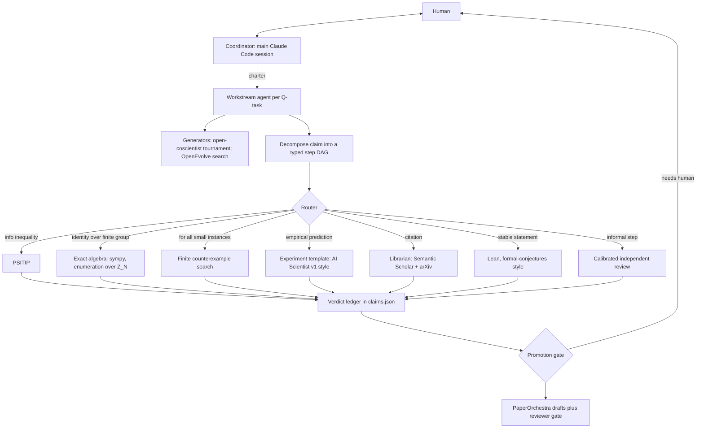

# The research harness: how it runs and how it verifies

*v0.1 · 2026-11-22. This turns [`tooling.md`](tooling.md) into an operating specification. "Exists" marks a part that is already in the repo. "Build" marks a part that is proposed. The first verifier, the PSITIP pilot, has run: [`proofs/psitip/RESULTS.md`](proofs/psitip/RESULTS.md).*

## 1. Summary

The harness is a co-mathematician-style workbench running on Claude Code. Its shared state is `program/data/*.json` on a git branch.

- A **coordinator** turns tasks into workstreams. Each workstream decomposes its claim into typed steps.
- A **router** sends every step to the strongest verifier available for its type: an information-inequality prover, exact computation, finite counterexample search, a simulation template, a citation check, or Lean.
- Steps no machine can check go through a calibrated, *conditionally independent* review protocol, which ends at a human gate.
- Nothing advances a claim except a recorded verdict. Every failure is kept.

All LLM calls, including those inside third-party tools, go through `claude -p`, so they run on the subscription.



## 2. Roles

| Role | Runs as | Reads | Writes | Source of the design |
|---|---|---|---|---|
| **Coordinator** | The main Claude Code session | `tasks.json`, `claims.json`, workstream reports | Charters, task status, escalations to the human | Co-mathematician's project coordinator |
| **Workstream agent** | A subagent (short tasks) or a cloud session (long ones), one per Q-task | Its charter and its claims' dependencies | `workstreams/<Q>/report.md`, `steps.json`, `failures.md`, artifacts | Co-mathematician's workstream coordinator |
| **Generator** | open-coscientist via a LiteLLM provider that calls `claude -p`; OpenEvolve | Charter, claim, prior failures | Candidate statements, falsifiers, constructions, ranked by Elo | Co-scientist; AlphaEvolve |
| **Router** | A deterministic script, `tools/route.py` (build) | `steps.json` | One verifier job per step | AlphaGeometry's split between symbolic engine and LM |
| **Verifiers** | Scripts under `program/proofs/` and `program/experiments/` | One job each | A verdict plus the artifact that reproduces it | PSITIP, sympy/numpy, AI Scientist templates, Lean |
| **Reviewers** | Fresh `claude -p` processes with no shared context, from mixed models | One step or one proof, blind to the author's reasoning where possible | Step verdicts with reasons | Co-mathematician's persistent reviewers; AI Scientist `perform_review.py` |
| **Librarian** | A script plus an agent | Bibliography entries | `status`, URL, supporting quote | Co-mathematician's citation checking; `AGENTS.md` protocol |
| **Writer** | PaperOrchestra (exists) | Verified claims only | Drafts, which must pass the review gate | PaperOrchestra; AI Scientist reviewer |
| **Human** | You | Review packets | Approvals, modeling decisions, steering | Every source system keeps a human gate |

## 3. State and artifacts

```
program/
  data/claims.json            canonical; gains a "verification" object per claim (build, §6)
  data/tasks.json             goals; each Q-task is one workstream
  workstreams/<Q>/            build
    charter.md                goal, claims in scope, acceptance criterion, required verification tier
    steps.json                the claim decomposed into typed steps (schema in §5.1)
    report.md                 working paper; each assertion carries a margin tag [K10/step-3: PSITIP ✓]
    failures.md               dead ends, refuted variants, reviewer rejections: append-only, never pruned
    reviews/                  raw reviewer transcripts, one file per round
  proofs/<verifier>/          reproducible verifier inputs and outputs (exists: psitip/)
  experiments/<template>/     simulation templates and run records (build: cyclic_world/)
  tools/validate.py           extended with verification-gate checks (exists; extend)
  tools/verify_all.py         re-runs every mechanical verifier; a red run blocks promotion (build)
```

**Invariants**, enforced by `validate.py`:

- A claim's verification tier is never higher than the lowest tier among its `depends_on` claims, unless the dependency is marked `assumed`.
- Every verdict points to an artifact, and `verify_all.py` can reproduce it.
- `refuted` is terminal for a statement. A corrected statement is a new claim version, and the refuted one stays in place with its counterexample.

## 4. One workstream, end to end

This uses the real first task, **Q-08 (finite-world proofs)**. Rows 1–4 of the walk are partly done already, through the PSITIP pilot.

1. **Charter.** The coordinator writes `workstreams/Q-08/charter.md`.
   - Scope: GM T1, T2, T4.1–2, T5, C11; K10, K26.
   - Acceptance: every claim reaches tier V3, or is refuted.
   - The human approves the charter, as in co-mathematician's goal approval.
2. **Formalize statements.** The workstream agent restates each claim with explicit quantifiers and with symbols taken from the notation registry (Q-04).
   - A second agent **back-translates** the formal statement into English without seeing the original.
   - A diff check flags any drift in meaning. Most real errors enter during translation.
3. **Generate variants.** For each claim, the open-coscientist tournament produces 5–10 variants: weaker hypotheses, stronger conclusions, alternative definitions of 𝒢. These are ranked by how much they would unlock among the claims that depend on this one.
   - The originals stay in scope.
   - Variants are kept as `conjecture` entries with falsifiers.
4. **Decompose.** Each claim becomes a step DAG in `steps.json`, with every step typed (§5.1). Example for GM T4.2:
   - step 1: chain rule (identity);
   - step 2: "a function of (D, ξ) carries no more information than (D, ξ)" (info inequality);
   - step 3: the hypothesis ξ ⊥ Ω | D (assumption);
   - conclusion (info inequality).
5. **Route and run.** Steps 1, 2 and the conclusion go to PSITIP. The pilot returned *True* for the corrected statement and *False* for the original, and the XOR counterexample confirmed the refutation numerically.
6. **Run the AlphaGeometry loop** when a step won't close:
   - (a) search finite distributions for a counterexample (§5.2.3);
   - (b) if none is found, the generator proposes auxiliary variables or an extra hypothesis, and the step is retried;
   - (c) failed attempts go to `failures.md`.
7. **Ablate hypotheses.** For every proved claim, re-run with each hypothesis removed.
   - A hypothesis that can be dropped is flagged as unused. The pilot found that GM T4.1's inequality needs none of its hypotheses.
   - A hypothesis whose removal gives a counterexample is recorded as load-bearing, with the counterexample: S26's conditional independence; MR1's verifier term.
8. **Review the residue.** Steps no machine checked (here, T4.1's strictness clause and T5) go to the review protocol (§5.3).
9. **Gate and record.** Verdicts are written to `claims.json` `verification`. `verify_all.py` and `validate.py` must both pass. Promotions that need a human produce a review packet (§5.3.7). Commit as `Q-08: …`.
10. **Escalate.** If review stalls for 3 rounds on any step, the coordinator stops the workstream, marks it `blocked` with the reason, and asks the human. Silent retries are not allowed.

## 5. Verification

### 5.1 Step types and their verifiers

Every step in `steps.json` has a `type`, and the type fixes the verifier:

```json
{"id": "T4.2/s2", "claim": "GM-T4", "type": "info_inequality",
 "statement": "I(W;C|D) <= I(W;xi|D) given H(C|D,xi)=0",
 "verifier": "psitip", "artifact": "proofs/psitip/pilot.py#row4", "verdict": "pass",
 "depends": ["T4.2/s1"], "checked": "2026-11-22"}
```

| Type | Verifier | What a pass means | Repo examples |
|---|---|---|---|
| `info_inequality` | PSITIP (LP, Shannon-type) | Proved (sound). A fail means only "not Shannon-provable" | GM T2/T4, K10, S26, MR1 (all done in the pilot) |
| `finite_identity` | sympy, exact over ℤ_N, D₁₂ and similar | Proved for the stated N; symbolic in N where sympy can do it | S1 for small groups; S4's odd harmonics vanish at s=½; S18's gains |
| `spectral_formula` | exact rational or algebraic computation, plus random instances | Proved for checked instances; general case needs review | S10 Plancherel CKA; S25 lower bound; S30 closure |
| `universal_small` ("for all small models…") | exhaustive enumeration up to a size bound, then randomized and adversarial search | No counterexample within the stated budget (evidence, **not** proof) | S22 low-pass ordering; S28 thresholds; K33 Rogers threshold |
| `dynamics` | exact Markov-chain computation for small populations, then simulation | Exact for small N; evidence beyond | K31 migration–drift (Wright–Fisher); S21 generational map |
| `empirical` | experiment template; pre-registered prediction; pass/fail | The prediction held or failed under the pre-registered analysis | E-01, E-04, E-12; X-series |
| `citation` | Librarian: primary page via Semantic Scholar or arXiv, plus a supporting quote | Source exists, the metadata matches, and the quote supports the use | All `from-memory` entries (Q-01, Q-02) |
| `formal` | Lean 4 + Mathlib | Machine-checked proof | Outline §8 items 1–4 |
| `informal` | Review protocol (§5.3) | Calibrated reviewers approved; residual risk stated | Strictness clauses; T3 selection identity; most of L4–L7 |
| `definition` / `correspondence` | Well-posedness checks plus the human gate | Accepted as a modeling choice or a reading, never "true" | K3 (Quine as identifiability); K45–K49 (Jauss) |

**Coverage.** A workstream reports what fraction of its steps went to a machine verifier. Raising that fraction is an explicit goal: each informal step is first examined to see whether it can be retyped.

### 5.2 Mechanical verification, in detail

1. **Fidelity of the encoding.** A solver checks the encoding, not the English. Every machine-checked step carries:
   - a back-translation by a second agent;
   - a sanity check (a known-false variant must fail; row 0 of the pilot);
   - an ablation (§4 step 7).

   This addresses the misformalization risk that `formal-conjectures` raises about its own statements.
2. **Reproducibility.** Every verdict is a script plus its pinned inputs. `verify_all.py` re-runs them all, which is co-mathematician's "continuous testing pipeline". A verdict that can't be reproduced is withdrawn automatically.
3. **Refutations need witnesses.** "Not provable" never sets `refuted`. Only a concrete counterexample does: a distribution, a group action, or a parameter setting, re-checked by code independent of the tool that found it. The pilot's XOR check deliberately uses no PSITIP code.
4. **Search budgets are part of the verdict.** "No counterexample" is recorded with its search space and budget, for example "all joint distributions on binary alphabets, grid of 21⁴ points, plus 10⁵ random draws on ternary alphabets". A reviewer can then judge whether the search was adequate.
5. **Simulations follow AI Scientist discipline,** with one addition: the prediction, the metric and the pass threshold are written in `experiments.json` *before* the run, and the code may not change after the result. This is the guard against the forking paths that end-to-end AI Scientist runs suffer from.

### 5.3 Verifying theory that has no solver and no runnable experiment

This covers most of L4–L7, the selection identity (GM T3), strictness and rate clauses, and the bridge claims. Seven mechanisms, applied in order. Each is weaker than a machine proof, and each is recorded as what it is.

1. **Shrink the informal residue.** Before any review, the workstream must try to *retype* each informal step:
   - Many "conceptual" steps are finite identities, inequalities, or "for all small cases" claims in disguise.
   - The test is whether the step has a finite instance: if it does, the instance is checked mechanically, and only the generalization stays informal.

   Example: K54's gaslighting-versus-psychosis precision theorem is about precision-weighted Gaussian updates. Those have closed forms, so most of it becomes `finite_identity` steps in sympy.

2. **Toy-model falsification.** Every claim must name its *smallest model*, the cheapest structure in which it is non-trivially true or false:
   - for the canon layer: a finite network of copies with survival probabilities;
   - for literariness as "epoch tolerance": a sequence of readers with drifting priors.

   The harness builds the model and runs adversarial counterexample search on it with OpenEvolve, or with random and exhaustive search.
   - Surviving the search is evidence (tier V2).
   - Failing it is a refutation of the claim *as formalized*. That is often the most valuable outcome, because it shows which hypothesis is missing.
   - For bridge claims, the toy model *is* the formal correspondence. If no toy model can be written, the claim is a `definition` or a `correspondence`, and it is labeled that way rather than reviewed as a theorem.

3. **Step-level adversarial review.** Reviewers judge single steps, not whole proofs, against a fixed attack checklist:
   - Is every hypothesis used, and used where it is stated?
   - Quantifier order and uniformity (does "for each ε" quietly become "for all ε"?).
   - Degenerate cases: zero-probability events, infinite alphabets, empty corpora, a single agent.
   - Swapping limits and expectations; measurability; existence of the objects named.
   - Circularity: does the step rely on a claim downstream of itself in `depends_on`?
   - Citation scope: does the step use a cited result beyond what the source proves? The Librarian supplies the exact statement.
   - Definition drift: do the symbols match the notation registry?

   Each reviewer returns `accept`, `reject` with a reason, or `cannot-assess`. Rejections go to `failures.md`. Reviewers persist across rounds of the same step, as in co-mathematician, so they can check that their objection was actually addressed.

4. **Independent verification channels.** This is the program's own S26 applied to the harness: *agreement between verifiers is evidence of correctness only if the verifiers are conditionally independent given the truth.* Five reviewers that share a model, a prompt and the author's framing are worth about one; their effective number is A_eff from S13. So:
   - **Blind re-derivation.** A separate agent gets only the formal statement and its dependencies, never the proof. It must produce its own proof or a counterexample. Two independent derivations that agree count far more than one proof read five times.
   - **Diversity is required:**
     - at least two model families or sizes (e.g. `opus` and `sonnet`), plus a different effort level;
     - different prompts (prove it, refute it, find the weakest hypothesis);
     - no shared context, since each reviewer is a fresh `claude -p` process.
   - **Refuter role.** One reviewer is always told the claim is false and asked for the counterexample. Its failure to find one is recorded with its search budget.
   - **Correlation monitoring.** If reviewers' verdicts across many steps are highly correlated, their votes are discounted. Correlated reviewers inflate agreement the way collapse inflates CKA (S25).

5. **Calibrate the reviewers.** A review configuration counts only if it has been shown to catch errors. The harness keeps a **seeded-error suite**:
   - The program's own history: GM T4.2 as written (false); T4.1's unused hypothesis; the Lean v2 "assumed growth" theorem (true for every channel, so vacuous); the wrong Karkada and Engels titles.
   - Mutations of verified proofs: drop a hypothesis, flip an inequality, swap quantifiers, cite a nearby wrong theorem.

   Each configuration (models, prompts, number of reviewers) is scored on its catch rate and its false-alarm rate. Only configurations above a threshold, for example ≥ 90% caught with ≤ 10% false alarms on the suite, may move a step to "reviewed". The suite is re-run whenever the underlying model changes. This uses the same evaluation discipline as the AI Scientist's reviewer benchmark (`review_iclr_bench/`), turned on the reviewers themselves.

6. **Graph consistency.** Some errors show up only between claims. `validate.py` (extended) checks:
   - acyclic dependencies;
   - that tiers are monotone along dependencies;
   - that no two `verified` claims contradict each other. Pairs of claims that share symbols are sent to a contradiction reviewer.
   - that every falsifier is reachable by some experiment or toy model, or is explicitly marked untested.

7. **The human gate, with a review packet.** These always need you, or a specialist you name:
   - definitions and modeling choices;
   - every `correspondence` claim (the four conditions in `program.md` CONNECT);
   - any promotion to `known` that lacks an end-to-end machine check;
   - anything leaving the repo.

   The harness prepares a packet so the human reviews efficiently, not from scratch. It contains:
   - statement;
   - back-translation;
   - step DAG with each step's verifier and verdict;
   - informal residue, highlighted;
   - reviewer transcripts;
   - counterexample searches and their budgets;
   - the claim's falsifier and what was done to try it.

### 5.4 Verification tiers

The tier is a separate axis from `status`. `status` says whether a result is known, new or a conjecture; the tier says how well it has been checked.

| Tier | Name | Requirement |
|---|---|---|
| V0 | Stated | Statement, falsifier and dependencies present (today's state for most claims) |
| V1 | Well-posed | Symbols resolve in the notation registry; quantifiers explicit; back-translation agrees |
| V2 | Survives search | No counterexample in its smallest model, within a recorded budget |
| V3 | Reviewed | All machine-typed steps pass; informal steps accepted by a calibrated, diverse review configuration |
| V4 | Independently established | Blind re-derivation agrees, **or** the whole claim is mechanically proved (e.g. PSITIP end to end) |
| V5 | Formal | Lean proof, or a published proof whose statement the Librarian has matched to ours |
| R | Refuted | Counterexample re-checked by independent code; a corrected version may be filed as a new claim |

**Promotion rules:**

- A claim enters a bridge essay only at V3 or above.
- A master relation (MR1–MR5) counts as proved only at V4 or above.
- A claim can be promoted from `conjecture` to `known` only at V4, together with the human gate.

**Pilot outcomes, as candidate tiers pending review:**

- GM T2, T4.2 (corrected), S26 and MR1 (both under the Markov condition): V4 candidates, because PSITIP proved them end to end.
- GM T4.2 as written: R.
- GM T4.1: inequality at V4, but needing restatement, since its strictness clause is still V0.

## 6. Proposed `verification` object in `claims.json`

```json
"verification": {
  "tier": "V4",
  "verdicts": [
    {"step": "MR1/main", "verifier": "psitip", "verdict": "pass",
     "artifact": "proofs/psitip/pilot.py#row10", "date": "2026-11-22"},
    {"step": "MR1/ablate-verifier-term", "verifier": "psitip+numeric", "verdict": "load-bearing",
     "artifact": "proofs/psitip/RESULTS.md#counterexamples"}
  ],
  "informal_residue": [],
  "reviews": [],
  "human_gate": "pending",
  "notes": "Holds under Omega-(D,E)-(Theta,Y); claims.json 'condition' field states the T4.2 condition instead; reconcile"
}
```

## 7. How it runs, mechanically

- **Inference.** Every model call is a Claude Code call on your subscription:
  - the coordinator and workstreams are Claude Code sessions;
  - third-party tools call `claude -p` through shims: `paperorchestra/claude_backend.py` (exists); a LiteLLM `CustomLLM` provider for open-coscientist (build); a wrapper for `ai_scientist/llm.py` (build).
  - Reviewers are separate `claude -p` processes with no MCP servers, no project settings, a replaced system prompt and an explicit `--model`. That gives the clean, independent contexts that §5.3 item 4 needs.
- **Parallelism.** Up to about 3 concurrent `claude -p` processes by default (`PO_CLAUDE_CONCURRENCY`). Long workstreams run as separate cloud sessions so they don't block the coordinator.
- **Enforcement.** Gates are code, not prompts: `validate.py` and `verify_all.py` must exit 0 before a commit that changes a tier. A Claude Code hook can block such commits otherwise (`/update-config`).
- **Network.** Semantic Scholar and arXiv are allowed; WebSearch runs on Anthropic's side. PSITIP, sympy and simulations run locally. Lean and the Mathlib cache need hosts that are not yet allowed; ask before adding them.

## 8. What is built and what to build

| Piece | State | Effort |
|---|---|---|
| PaperOrchestra plus Claude Code backend | Exists | — |
| PSITIP verifier; pilot on 11 claims, 4 ablations, 3 counterexamples | Exists (`proofs/psitip/`) | — |
| `workstreams/` conventions, `steps.json` schema, `refuted` status, `verification` object, `validate.py` gate checks | Build | Small |
| `verify_all.py` (re-runs `proofs/` and `experiments/`) | Build | Small |
| Review protocol: blind re-derivation, refuter role, diverse reviewer configurations, review-packet generator | Build | Medium |
| Seeded-error calibration suite (from repo history plus mutations) | Build | Medium; do this before trusting any V3 |
| `experiments/cyclic_world/` template with exact 𝒢 and unit tests from S4 and S18 | Build | Medium |
| open-coscientist with a `claude -p` LiteLLM provider and a domain YAML | Build | Small–medium |
| OpenEvolve for counterexample search | Build when needed | Medium |
| Lean toolchain plus `formal-conjectures`-style statements | Build when hosts are allowed | Medium–large |

**Recommended order:**

1. Conventions and gates.
2. The calibration suite. Without it, V3 means nothing.
3. Apply the pilot's findings to `claims.json` through the human gate.
4. The cyclic-world template.
5. The co-scientist tournament for variants and falsifiers.
6. Lean.

## 9. Limits, stated plainly

- **PSITIP is incomplete** beyond Shannon-type inequalities and doesn't handle rates, limits or strict inequalities. Those stay with exact computation, search and review.
- **Review raises confidence; it doesn't prove.** Calibration measures how much it raises it, and only on the kinds of errors in the suite.
- **The harness cannot decide whether a formalization is a faithful *reading*** of Jauss, Quine or Firth. It can only make the correspondence explicit and testable, then hand it to a person.
- **Cost:** blind re-derivation and diverse reviewers multiply model calls. Spend them where claims carry weight: the master relations and anything that goes into a bridge.
